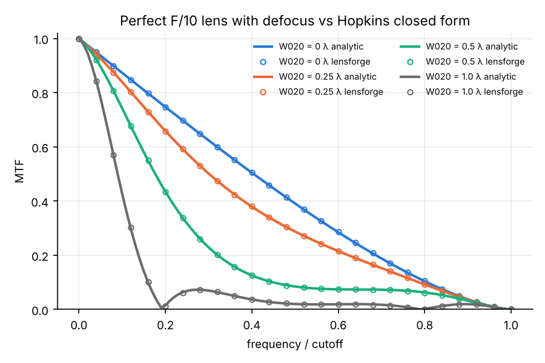
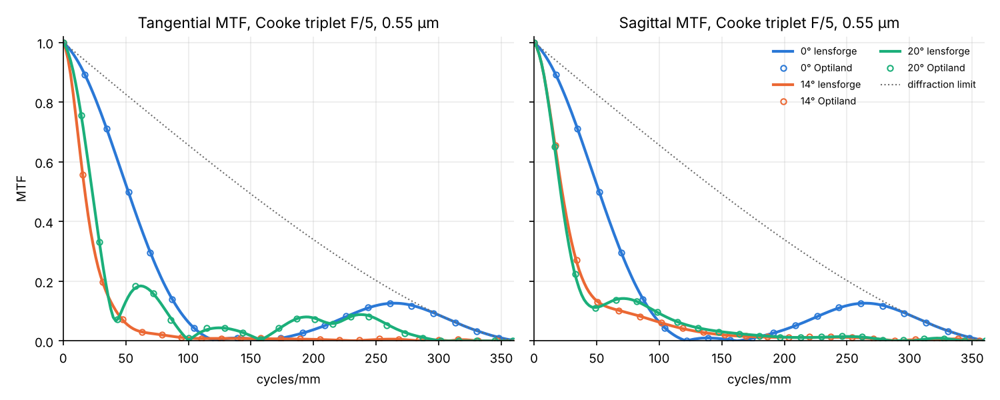

# MTF validation

How lensforge's MTF was checked (November 2026). The numbers are pinned in
`tests/test_analysis_quality.py` and `tests/test_mtf_reference.py`.

## 1. Code review

* FFT MTF = |FFT of the FFT PSF|, normalised to 1 at zero frequency. The PSF is a
  matrix Fourier transform of the sampled exit-pupil function at Nyquist pixels
  (lambda_min / 4 NA) over exactly one period of the sampled-pupil PSF, so the
  discrete OTF is the exact autocorrelation of the sampled pupil. The only
  approximation is the pupil grid (staircase edge), which shrinks with `pupil_n`.
* Frequencies are cycles per lens unit (cycles/mm for mm lenses); the cutoff is
  2 NA / lambda_min. Tangential = frequencies along y for a field on the y axis.
* Polychromatic MTF sums the weighted PSFs (each with unit energy) and then
  transforms, i.e. the weighted sum of complex OTFs, with every wavelength referenced
  to the primary chief ray, so lateral colour lowers the MTF as it should.
* Geometric MTF = |Fourier transform of the ray-intercept density|, optionally times
  the diffraction-limited MTF (the OpticStudio "scale by diffraction limit" option).
* Fixed: a frequency past the end of the PSF grid used to return the last grid value
  (np.interp clamps). With a PSF pixel coarser than Nyquist (scripting `dx=`) the MTF
  was silently aliased. Now frequencies at or past the cutoff are 0, unresolvable
  ones are NaN, and the result carries a warning (shown on the Qt MTF plot).

## 2. Analytic references

Perfect lens (ideal paraxial surface, F/10 and F/2), with and without defocus,
against the circular-pupil formula and Hopkins' closed form for defocus
(OTF(s) = 4/(pi a) int_0^sqrt(1-s^2) sin(a(sqrt(1-y^2) - s)) dy, a = 8 pi W020 s):

| Case | max abs error, pupil_n 64 | pupil_n 256 | Strehl (expected) |
|---|---|---|---|
| F/10 perfect | 0.0015 | 0.0001 | 1.000 (1) |
| F/10, W020 = 0.25 wave | 0.0009 | 0.0001 | 0.811 (0.811) |
| F/10, W020 = 0.5 wave | 0.0007 | 0.0012 | 0.407 (0.405) |
| F/10, W020 = 1 wave | 0.0033 | 0.0035 | 0.048 peak, 0 on axis |
| F/2 perfect | 0.0018 | 0.0004 | 1.000 |
| F/2, W020 = 0.5 wave | 0.0022 | 0.0025 | 0.409 |

The residual at W020 = 1 wave comes from the real ideal-lens wavefront (fitted
W020 = 0.997, W040 = -0.002 waves), not from the MTF code. lensforge's Strehl is
peak / perfect peak, as in OpticStudio, so at 1 wave of defocus it reports the
brightest ring rather than the dark centre.

## 3. Published prescription

The Cooke triplet of the Optiland gallery (the OpticStudio "Cooke 40 degree field"
sample: EFL 50 mm, F/5, EPD 10, fields 0/14/20 deg, SK16 and F2, 0.48/0.55/0.65 um).
Published values on that page against lensforge:

| Quantity | Published | lensforge |
|---|---|---|
| EFL | 49.99978 mm | 49.99998 mm |
| Strehl, on axis, 0.55 um | 0.3082 | 0.3088 |

(Optiland resolves "SK16" to N-SK16; lensforge uses N-SK16 and SCHOTT F2.)

## 4. Mature open-source package: Optiland 0.6.3

Same prescription, 0.55 um, FFT MTF with 128 pupil samples in both codes:

| Field | freq (c/mm) | 25 | 50 | 75 | 100 | 150 | 200 |
|---|---|---|---|---|---|---|---|
| 0 deg | lensforge | 0.819 | 0.525 | 0.243 | 0.063 | 0.007 | 0.038 |
| | Optiland | 0.819 | 0.525 | 0.242 | 0.063 | 0.007 | 0.039 |
| 14 deg T | lensforge | 0.299 | 0.060 | 0.023 | 0.010 | 0.008 | 0.006 |
| | Optiland | 0.306 | 0.062 | 0.024 | 0.010 | 0.009 | 0.006 |
| 14 deg S | lensforge | 0.437 | 0.134 | 0.095 | 0.063 | 0.021 | 0.012 |
| | Optiland | 0.445 | 0.135 | 0.093 | 0.063 | 0.022 | 0.013 |
| 20 deg T | lensforge | 0.447 | 0.131 | 0.143 | 0.004 | 0.018 | 0.077 |
| | Optiland | 0.442 | 0.139 | 0.141 | 0.010 | 0.016 | 0.074 |
| 20 deg S | lensforge | 0.393 | 0.113 | 0.141 | 0.092 | 0.031 | 0.013 |
| | Optiland | 0.397 | 0.112 | 0.140 | 0.094 | 0.030 | 0.013 |

Largest difference 0.008 (off axis); on axis within 0.001. The off-axis residual is
the frequency scale: lensforge fits the image-space NA to all pupil rays, Optiland
uses the marginal-ray direction differences projected on the image plane.
Geometric MTF (200 x 200 rays) agrees to 0.002 at every field and frequency.

`tests/test_mtf_reference.py` also re-runs the comparison live when Optiland is
installed (`pip install optiland`).
